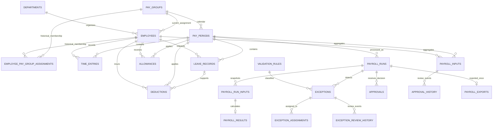

# Database Schema

The canonical SQLite DDL is [`schema.sql`](../src/payroll_validation/database/schema.sql). [`init_db.py`](../src/payroll_validation/database/init_db.py) applies additive, data-preserving migrations and verifies integrity. Each connection enables `PRAGMA foreign_keys=ON`. The schema currently has **21 tables and 39 declared foreign-key relationships**, including the 12 required business entities and supporting history/bridge tables.

## Entity relationship design

## Tables

The 12 required entities are `employees`, `pay_groups`, `pay_periods`, `time_entries`, `leave_records`, `allowances`, `deductions`, `payroll_inputs`, `validation_rules`, `exceptions`, `approvals`, and `payroll_exports`. Supporting relational/history tables are `departments`, `employee_pay_group_assignments`, `payroll_runs`, `payroll_run_inputs`, `payroll_results`, `approval_history`, `exception_assignments`, `exception_review_history`, and `audit_events` (21 total).

`employee_pay_group_assignments` is the effective-dated bridge for the many-to-many Employee ↔ PayGroup history. The `employees.pay_group_id` field remains the current assignment for compatibility with current services. A trigger records current-group changes in the bridge and rejects overlapping non-cancelled effective intervals. Assignment end dates are exclusive.

`payroll_run_inputs` is the immutable calculation snapshot for one employee and payroll run. `payroll_results.payroll_run_input_id` is a unique, non-null FK, creating a one-to-one run-input/result relation. Triggers additionally enforce employee/run and period consistency. A payroll run has one or more snapshots/results. `payroll_exports.payroll_run_id` has a unique index, so only one finalized export record can be created per run.

## Keys, integrity and lifecycle

Every table has an integer primary key. Business IDs (such as `EMP-000001`, `PP-2026-01`, time-entry and payroll-input codes, and `PEX-2026-000001`) have unique constraints and immutable-ID triggers. FKs use `ON UPDATE RESTRICT ON DELETE RESTRICT` to preserve referenced payroll and audit history. Historical corrections are represented by new rows with `supersedes_*_id` links.

The schema constrains enumerated lifecycle states, non-negative hour and currency amounts, date order, status/boolean domains, and unique business grains. Cross-table triggers enforce matching employee/pay-period pay groups, source dates within their period, exception/rule correspondence, run/period consistency, and approval-history linkage. `audit_events` retains before/after JSON and actor/time data; approval and exception workflows have append-only event tables. Its `entity_type/entity_id` pair is deliberately polymorphic; actor identity is a local demo string and has no user-directory FK.

Indexes cover FK joins, employee-period source lookups, period dates, payroll run/status and result access, exception workflow, approval/assignment histories, effective group membership, audit timelines, and uniqueness boundaries.

## Existing database migration

`initialize(path)` uses additive `CREATE ... IF NOT EXISTS` and `ALTER TABLE ADD COLUMN` migrations. It preserves existing table rows, adds the employee/pay-group bridge from the prior current assignment, reconstructs missing run-input snapshots from stored payroll results/input aggregates, and links existing results to those snapshots. It does not rebuild or drop tables. A pre-migration SQLite backup is retained before applying a migration to an existing project database.

Run `python -m payroll_validation.database.init_db` from the project root. Verification reports table and FK counts, SQLite `integrity_check`, `foreign_key_check`, payroll result links, run-period consistency, and employee assignment coverage.
